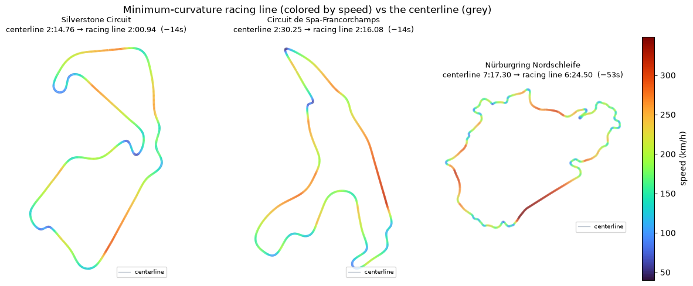
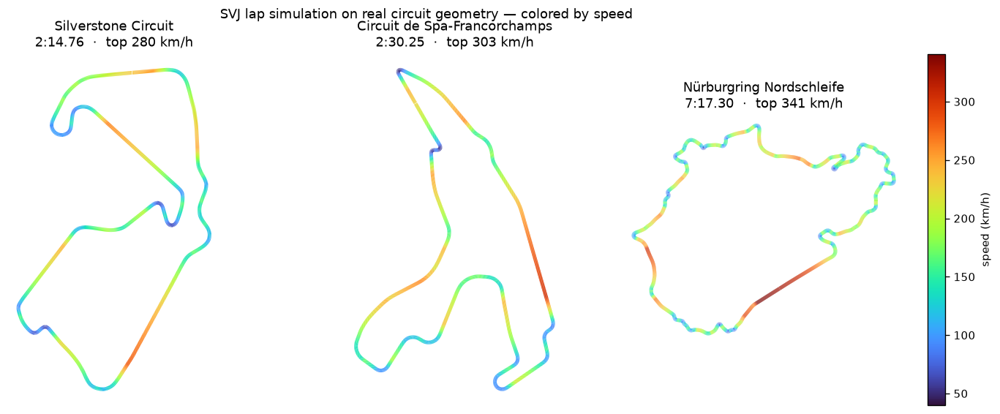
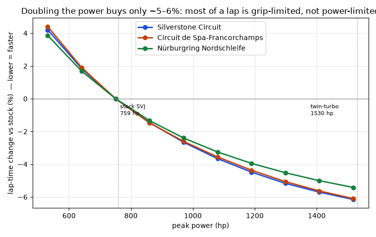
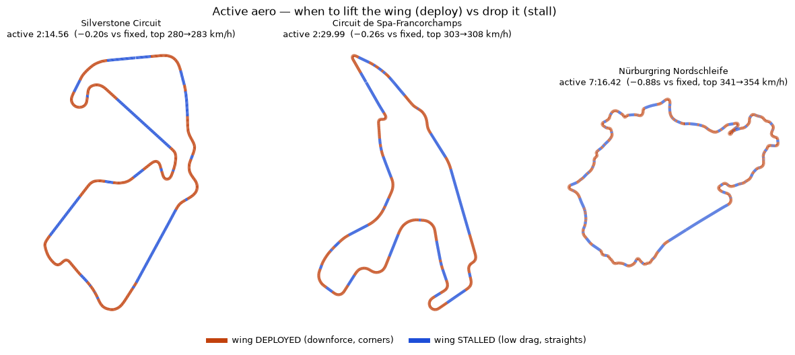
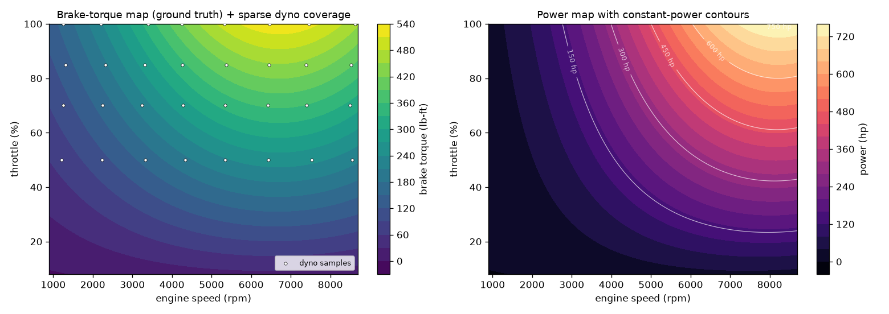
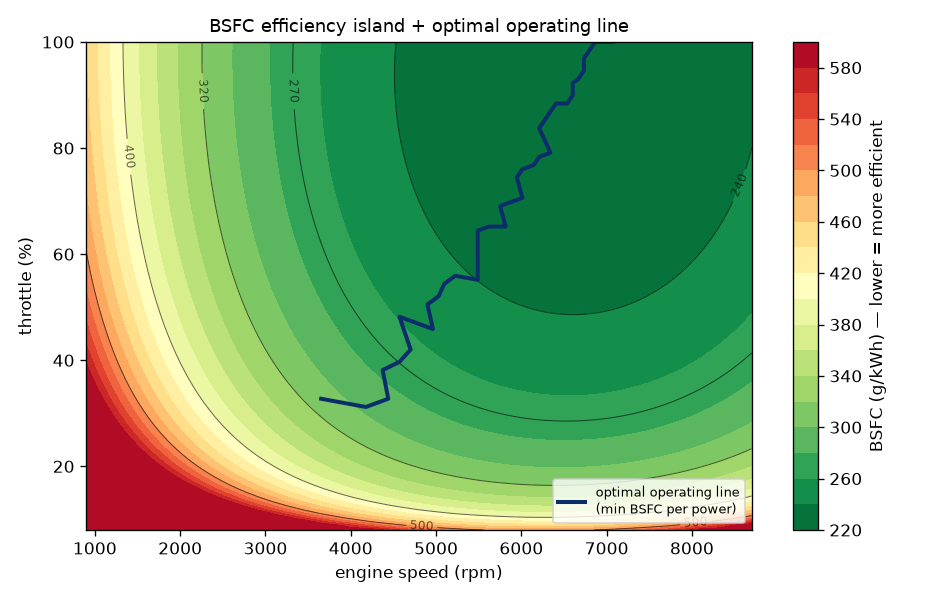
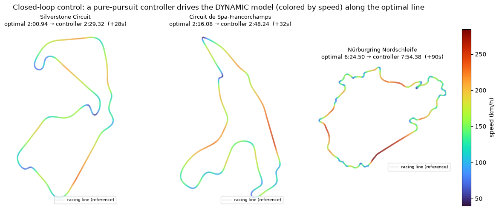
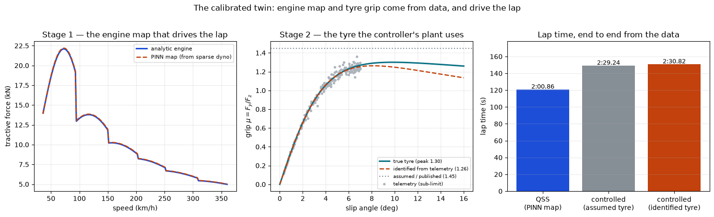
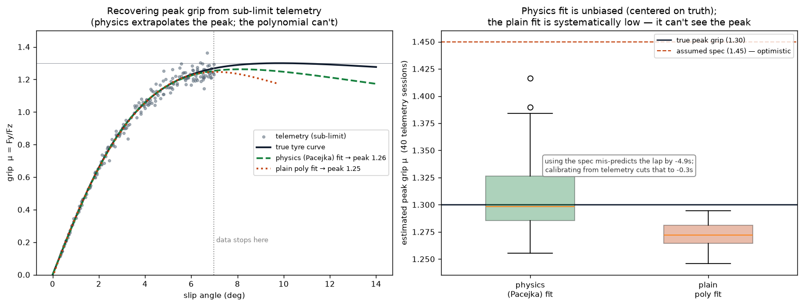

# From a dyno pull to a Nürburgring lap

[](https://github.com/raahimnawaz/engine-map-pinn/actions/workflows/ci.yml)
[](LICENSE)
[](https://www.python.org/)

A physics pipeline that takes an engine's dyno curve and predicts how the car
laps a real racetrack — engine map → vehicle dynamics → lap-time simulation —
on real geometry for **Silverstone, Spa, and the Nürburgring Nordschleife**.
The car modeled is the **Lamborghini Aventador SVJ**.

> **Used in** [parc-ferme](https://github.com/raahimnawaz/parc-ferme), post-session engineering debriefs for 2026 F1, which ports this repo's track model and lap simulator and extends them for 2026.

> **Why I built this.** I kept seeing the racing-line and telemetry overlays in
> Forza — the glowing line through a corner, the speed readout — and wanted to
> know what's actually *under* it: how do you compute the fastest line, and how
> much does the engine even matter versus the tyres? So I built the real physics
> behind that overlay, from the dyno curve all the way to a lap time.



## The headline results

The SVJ on three real circuits, simulated from the engine curve up:

| Circuit | Length | Lap (centerline) | Lap (racing line) | Top speed |
|---|---|---|---|---|
| **Silverstone** | 5.88 km | 2:14.8 | **2:00.9** | 280 km/h |
| **Spa-Francorchamps** | 6.99 km | 2:30.3 | **2:16.1** | 303 km/h |
| **Nürburgring Nordschleife** | 20.77 km | 7:17.3 | **6:24.5** | 341 km/h |



**Honest validation — the model brackets reality.** The SVJ's real Nordschleife
record is **6:44.97**. My two estimates straddle it: the *centerline* lap (7:17)
is too slow because the centerline isn't the fast way round, and the
*minimum-curvature racing line* (6:24) is a touch too fast because it over-flattens
corners under a constant-width assumption and optimizes curvature, not time. The
truth sits between them — which is about the best a first-order quasi-steady-state
sim should claim. I'd rather show that honestly than tune a knob to hit 6:44.

## Two findings worth the build

**1. More power barely helps.** Doubling the engine — the stock 759 hp SVJ to a
1530 hp twin-turbo build — makes it only **5–6% faster** on every track, because
most of a lap is **grip-limited, not power-limited** (the Nordschleife is ~50%
grip-limited). The tyres, not the engine, are usually the bottleneck.



**2. The racing line is worth far more than the engine.** Re-optimizing the
*path* (minimum-curvature line within the track width) saves 14 s at Silverstone
and ~53 s on the Nordschleife — an order of magnitude more than doubling the
power. Where you point the car beats how much power it has.

**3. Active aero — lift the wing in corners, drop it on straights.** Modeling
the SVJ's ALA system (deploy downforce when grip-limited or braking, stall the
wing for low drag on power-limited straights) beats either fixed setup, and adds
top speed where it matters (Nordschleife 341 → **354 km/h** down Döttinger Höhe).
The control logic falls straight out of the grip/power limit classification.



## How it works — three stages, and where the ML actually is

```
sparse dyno pulls ─[PINN: reconstruct]→ engine map ─[lap sim: physics]→ lap time ─[optimize: search]→ faster lap
```

- **Stage 1 — engine map (a PINN).** A few noisy dyno sweeps don't cover the
  whole operating range; a physics-informed network reconstructs the full
  torque/power/fuel map from them (power = torque·ω and affine-in-load are baked
  in as residuals). It's a *reconstructor*, not an optimizer — it cleans the dyno
  data into a usable map. **Honest note:** I tested whether the physics prior
  actually helps and it only does when data is genuinely sparse — with a normal
  amount of logged data a plain network is just as good (`figures/when_physics_helps.png`).

  
  

  *The reconstructed torque/power maps (validated against the SVJ's published 759 hp
  / 531 lb-ft) and the BSFC efficiency island with its optimal operating line. More
  engine-map figures and the PINN study in [`docs/engine_map.md`](docs/engine_map.md).*
- **Stage 2 — lap simulation (physics, not ML).** A quasi-steady-state solver:
  corner-speed limits from the friction circle, a forward pass limited by the
  engine map and traction, a backward braking pass, integrated around the real
  circuit geometry. This is the standard motorsport tool.
- **Stage 3 — optimization (the "go faster" part).** Wrap a search around the
  sim and it finds faster setups: the minimum-curvature racing line above, a
  per-track final-drive optimization (`figures/optimize_gearing.png`), and the
  active-aero schedule.
- **Stage 4 — control (closed loop on a dynamic model).** The QSS racing line is
  the *optimal reference*; a controller then has to actually *drive* it on a model
  with real dynamics. `dynamics.py` is a dynamic bicycle model with Pacejka tyres
  (validated — its steady-state cornering radius matches the Ackermann estimate),
  and the longitudinal channel is a **real tyre force, not a free input**: a
  friction circle shares grip between cornering and braking/accel, and drive is
  capped by the engine map through the gearbox. So the car cannot brake past the
  tyre or out-accelerate the engine. A **pure-pursuit + anticipatory-braking
  controller drives it around all three circuits in closed loop**, tracking the
  racing line to **0.45–0.63 m on average (worst-case 3.8 m — verified inside the
  track on every circuit)** and lapping **~23% off the QSS optimal**. That gap is
  the honest cost of real dynamics (tyre slip, yaw), a grip-limited plant, and a
  simple tracking controller vs the theoretical point-mass optimum.



  The braking has to be *anticipatory* — on a grip-limited plant a reactive speed
  law cannot shed speed **at** a corner, so it must slow **before** one. The
  controller also keeps a speed margin under the QSS optimum (0.82); the fastest
  setting that still keeps the car inside the track everywhere, with the narrow
  Nordschleife the binding case. Pushing that margin looks ~10% faster on paper
  but puts the car metres off the road, which is not a lap.

  A second, more ambitious controller — an **MPCC** (model-predictive contouring
  controller, `mpcc.py`, CasADi/IPOPT) — is reformulated in the **Frenet frame**
  (progress `s` + lateral `n` coordinates, which is what makes the NLP
  well-conditioned): it converges per step and tracks tightly on the parts of a
  lap it holds. It does **not** yet complete a full lap: its internal prediction
  model doesn't carry the plant's friction-circle limit, and a short horizon
  can't anticipate a corner at the end of a 300 km/h straight. Aligning the model
  and giving it global speed anticipation is the next step — see
  [`docs/vehicle-model-v2.md`](docs/vehicle-model-v2.md).

This is also where the **vehicle-dynamics repo** plugs in: its estimator fits
the Pacejka tyre / friction / drag parameters from real telemetry, calibrating
exactly the dynamic model the controller drives.

### The surrogates actually drive the pipeline



It's easy to bolt an ML model onto a physics project and never let it touch
anything. So this is wired end to end, and `scripts/make_calibrated_twin.py`
proves it: **delete the PINNs and the lap times change**, because they produce
the map and the tyre the car actually runs on.

- **Engine.** The PINN map, reconstructed from a handful of sparse noisy dyno
  samples, is wrapped as an engine (`pinn.PINNEngine`) and handed to the same
  `Vehicle` the lap sim uses. Its tractive-force curve overlays the analytic
  engine's (gear steps and all) and it laps Silverstone in **2:00.86 vs 2:00.94**
  — a **0.08 s** difference. The surrogate is good enough to *drive*, not just
  to plot.
- **Tyre.** The grip the controller's plant uses comes from
  `tire_id.fit_pacejka` on cornering telemetry, via
  `BicycleModel.from_pacejka(...)`. On a car whose real tyre peaks at
  **μ = 1.30**, trusting the published number (1.45) is off by **+0.15**;
  identifying it from sub-limit telemetry recovers **1.26** — about **4× closer**
  — and that changes the controlled lap.

Swap the simulated dyno samples for a real dyno/OBD log and the simulated
cornering data for real IMU telemetry, and the identical path calibrates a twin
of an *actual* car. That's the digital-twin goal, and the plumbing for it is now
real rather than aspirational.

### Calibrating grip from telemetry (the PINN-B role)



Lap time is set by the tyre's **peak** grip, but a driver mostly stays *below*
the limit, so the telemetry (lateral-g vs slip angle) rarely samples the peak —
recovering it needs the tyre *physics*. A grey-box **Pacejka fit extrapolates
the grip peak** from sub-limit data and is **unbiased** (centered on the true
peak across runs); a physics-free polynomial is **systematically low** because it
can't see past the data. Feeding the calibrated grip back into the lap sim
matters — assuming the published μ here mis-predicts the lap by **~5 s**, and
calibrating from telemetry cuts that to **~0.3 s** (`enginemap/tire_id.py`).

This mirrors the **VD repo's PINN-B**, which fits the same tyre curve. Honest
note from comparing them: VD's PINN-B is the *rigorous* version — it recovers μ
from **deceleration trajectories via an ODE-residual loss** (longitudinal tyre
force isn't directly measurable) and has a free-form `MuNet` (with a concavity
prior) alongside the grey-box `PacejkaNet`. This repo's `tire_id` is the lateral,
steady-cornering counterpart and includes the same two families — but the
free-form net is **unreliable for sub-limit extrapolation** (it collapses or
overshoots when the data never reaches the peak), so the **grey-box parametric
fit is the dependable estimator here**, reinforcing VD's own finding that the
parametric prior recovers the curve most cleanly.

The engine map validates against the SVJ's real published peaks (759 hp / 531
lb-ft); details and the map/BSFC figures are in [`docs/engine_map.md`](docs/engine_map.md).

## Data provenance (it's real geometry)

- **Silverstone, Spa** — centerlines from the [f1-circuits](https://github.com/bacinger/f1-circuits) dataset.
- **Nordschleife** — stitched from OpenStreetMap `highway=raceway` ways into a
  single 20.77 km loop (matches the real 20.8 km).
- **Engine** — a mean-value V12 calibrated to the SVJ's published figures (no
  proprietary dyno data exists publicly; the twin-turbo variant is a plausible
  *what-if*, not a measurement).

## Honest scope

Quasi-steady-state, point-mass; constant track width; the engine map is
simulated, not a real dyno log. So **absolute** lap times are approximate (hence
the bracket around the real record). The **relative** results — track vs track,
power vs grip, centerline vs racing line — are the trustworthy part, and the
telemetry path (`enginemap/telemetry.py`, simulated now, real OBD-II later)
replaces simulated inputs with measured ones.

On the **racing line**: the default is minimum-*curvature* (a fast, cheap
proxy). `raceline.optimize_min_time` optimizes the line offsets directly against
the lap simulator's lap *time* instead — and on Silverstone it finds only
~0.03 s over the curvature line, confirming the proxy is near-optimal here. (It
would matter more on a circuit dominated by a slow corner feeding a long
straight, where you'd trade corner speed for exit speed; it's also ~100× slower,
so it's opt-in, not the default.)

## Roadmap / next steps

The build order so far: engine map → lap sim → racing line → active aero →
closed-loop control → tyre-grip ID. What's next, roughly in priority:

1. **MPCC → a full timed lap.** The controller now solves against the same
   grip-, slip- and actuator-limited car the plant enforces, plus a
   grip-feasible global speed reference so it can brake for corners past its
   horizon. It drives ~39% of Silverstone cleanly (sub-metre tracking, ~1 solver
   failure in 500 steps) and then oscillates in the long braking zone into Stowe.
   Leading suspect is the 0.06 s control interval being too coarse to stabilise
   the yaw mode at the limit; **acados** would also make each experiment seconds
   rather than minutes. Progress log, exact failure location and ranked next
   steps: [`docs/vehicle-model-v2.md`](docs/vehicle-model-v2.md).
2. **Online grip adaptation (adaptive MPC).** μ is currently a fixed number the
   controller assumes — but the car continuously produces the very data
   `tire_id` needs (lateral g vs slip angle). Refitting it over a rolling window
   and feeding it back into the MPCC's friction circle lets the controller drive
   to the grip it *measures* rather than the grip it was told, which is what real
   tyres (warming, wearing, wet) actually demand.
3. **Close the real-data loop (the digital-twin goal).** Wire a real OBD-II +
   IMU/CAN logger (`telemetry.py` is built for it) to replace *simulated* inputs
   with measured ones: real engine map (dyno/OBD), real drag (coastdown), real
   grip (the measured **g-g diagram** → `tire_id`). The sim becomes a calibrated
   twin of an *actual* car, not a generic SVJ — and it is what makes the tyre ID
   non-circular.
4. **Tyre-ID rigor.** Adopt VD's ODE-residual approach for the brake-aware
   longitudinal case; the free-form net needs near-limit data to be reliable, so
   pair it with the grey-box fit.
5. **Dynamic aero as a control input.** Active aero is near bang-bang in the QSS
   sim; the genuinely dynamic case (an airbrake, stability modulation) belongs as
   a control input the MPCC chooses.
6. **Hardware.** The capstone: put the controller + a calibrated model on a real
   small vehicle / Jetson — the jump from simulation to a physical loop.

## Reproduce

```bash
uv venv --python 3.12 && uv pip install -e ".[dev]"
PYTHONPATH=src python scripts/make_laps.py        # lap sim + speed maps + power sweep
PYTHONPATH=src python scripts/make_raceline.py    # racing-line optimization
PYTHONPATH=src python scripts/make_aero.py        # active-aero deploy schedule
PYTHONPATH=src python scripts/make_control.py     # closed-loop control vs QSS optimal
PYTHONPATH=src python scripts/make_tire_calibration.py # tyre-grip ID from telemetry
PYTHONPATH=src python scripts/make_calibrated_twin.py  # PINN map + identified tyre -> a lap
PYTHONPATH=src python scripts/optimize_gearing.py # setup optimization
PYTHONPATH=src python scripts/make_figures.py     # engine map + the PINN study
uv pip install -e ".[control]"                    # MPCC scaffold needs casadi
uv run pytest -q
```

## Layout

```
src/enginemap/
  constants.py  shared physical constants (one car: one grip, one air density)
  engine.py     first-principles V12, calibrated to the SVJ
  pinn.py       physics-informed engine-map surrogate (+ PINNEngine: it drives the lap)
  track.py      load real circuit geometry -> curvature profile
  vehicle.py    SVJ vehicle model: engine map -> tractive force through the gearbox
  lapsim.py     quasi-steady-state lap-time solver (+ active-aero schedule)
  raceline.py   minimum-curvature racing-line optimizer
  dynamics.py   dynamic bicycle model, Pacejka tyres, friction circle + engine limit
  controller.py pure-pursuit + anticipatory braking (the working closed loop)
  mpcc.py       model-predictive contouring controller (per-step; not a full lap yet)
  tire_id.py    grey-box Pacejka grip identification from telemetry (PINN-B role)
  telemetry.py  OBD-II telemetry source (simulated now, real adapter later)
data/tracks/    real Silverstone / Spa / Nordschleife geometry
scripts/        reproduce every figure
```

## License

MIT.
